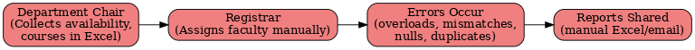
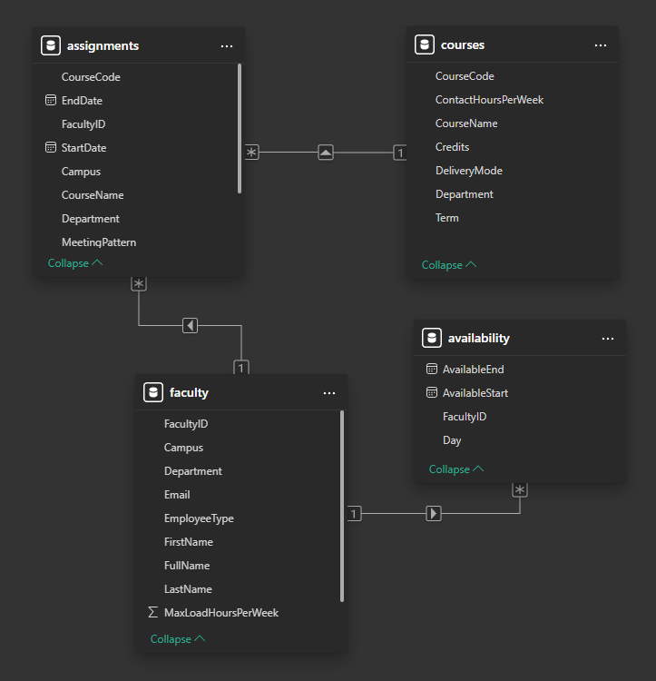
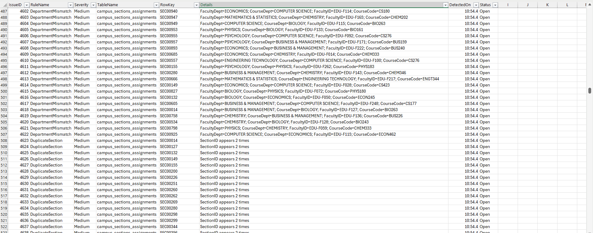
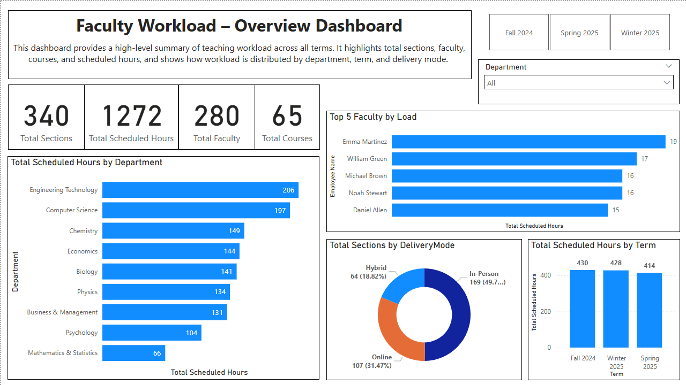
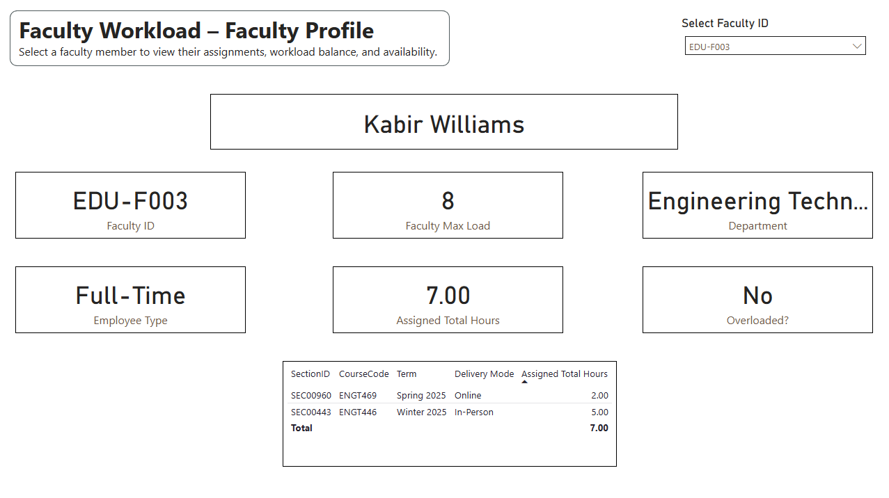
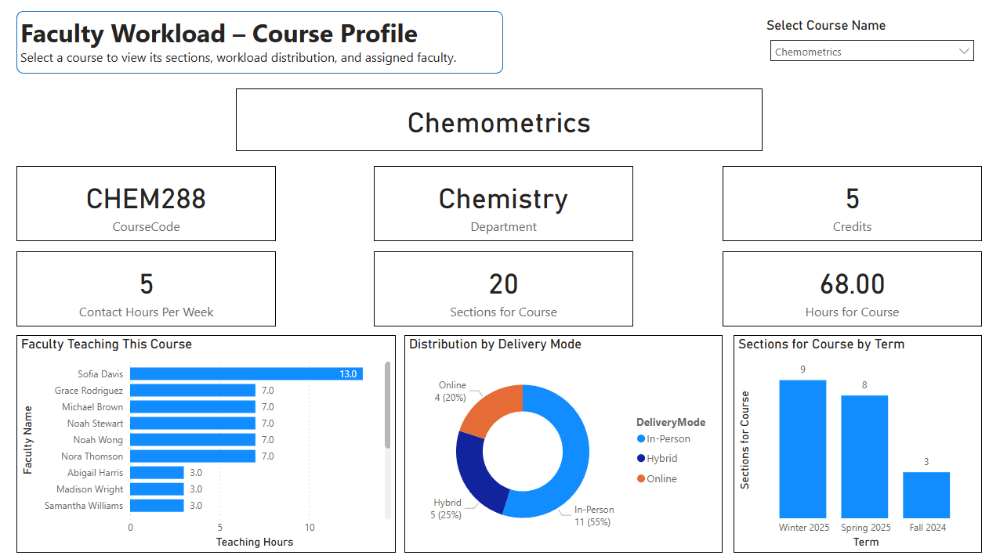

# Faculty Workload Intelligence – Requirements, SQL & UAT Delivery

A Business Analysis and Analytics portfolio project focused on faculty workload scheduling, academic resource allocation, SQL-based data validation, and business intelligence reporting.

The project simulates a university faculty workload management environment, demonstrating how business requirements, process analysis, data validation, exception tracking, and interactive dashboards can work together to support academic administration.

## 📌 Project Overview

Faculty workload scheduling involves coordinating faculty members, courses, teaching assignments, availability, and workload limits. Inaccurate assignments and scheduling inconsistencies can create operational challenges for academic administrators.

This project explores a structured approach to faculty workload analysis through:

- Business requirements documentation and process analysis.
- As-Is and To-Be process mapping.
- SQL Server-based data validation and exception detection.
- Faculty workload and scheduling analysis.
- Issue tracking and validation evidence.
- Power BI dashboards for operational insights.

## 🎯 Project Objectives

- Improve visibility into faculty workload distribution.
- Identify potential workload overloads and assignment inconsistencies.
- Detect department mismatches, duplicate assignments, and unassigned sections.
- Establish structured data validation and exception tracking.
- Provide interactive reporting to support academic resource allocation.
- Demonstrate the relationship between business requirements and technical implementation.

## 📂 Project Deliverables

| Deliverable | Description |
|---|---|
| Business Requirements Document | Business objectives, requirements, scope, and functional expectations |
| As-Is and To-Be Process Maps | Current and proposed faculty workload processes |
| Entity Relationship Diagram | Data entities and their relationships |
| SQL Validation Scripts | Data quality checks and exception detection |
| Issue Log | Centralized record of identified data issues |
| Power BI Dashboard | Three-page interactive workload analytics report |
| Supporting Documentation | Screenshots, datasets, and project evidence |

## 🛠 Technology Stack

- **SQL Server:** SQL queries, data validation, and workload analysis.
- **Microsoft Power BI:** Interactive dashboards and business intelligence reporting.
- **CSV:** Source datasets and issue-log exports.
- **Microsoft Visio / draw.io:** Process mapping and ER diagram documentation.

## 🏗 Project Structure

```text
faculty-workload-intelligence/
│
├── data/
│   ├── raw/
│   ├── master/
│   ├── sql/
│   └── TryQuery.sql
│
├── docs/
│   ├── BRD.md 
│   ├── UAT_Plan.md 
│   ├── process_maps/
│   └── erd/
│
├── reports/
│   ├── Dashboard.pbix
│   └── issue_log_export.csv
│
├── screenshots/
│   ├── 1.Overview_Dashboard.png
│   ├── 2.Faculty_Profile.png
│   ├── 3.Course_Profile.png
│   └── UAT_Testing.png
│
└── readme.md
```

## 📋 Business Analysis & Requirements

The project incorporates business analysis activities to translate faculty workload management needs into structured requirements and supporting documentation.

### Business Requirements Document (BRD)

Documents the business problem, project objectives, scope, requirements, business rules, and expected outcomes.

[View Business Requirements Document](docs/BRD.md)

### Process Mapping

The process maps illustrate the difference between the existing workload scheduling approach and a proposed structured process.

**Current State – As-Is**



**Future State – To-Be**


### Entity Relationship Diagram

The ERD illustrates the relationships between faculty, courses, availability, and section assignments.



## ⚙️ SQL-Based Data Validation

SQL Server scripts are used to examine faculty workload and assignment data and identify potential data quality issues.

The validation areas include:

| Validation Rule | Purpose |
|---|---|
| Faculty Overload | Identify faculty assignments exceeding workload limits |
| Unassigned Faculty | Identify sections without an assigned faculty member |
| Department Mismatch | Identify inconsistencies between faculty and course departments |
| Duplicate Section | Identify duplicate section assignments |
| Scheduling Checks | Examine assignment scheduling inconsistencies |

The identified exceptions are recorded in an issue log for investigation and follow-up.

### Issue Log

The issue log provides a centralized view of detected exceptions and includes fields such as:

- RuleName
- Severity
- TableName
- RowKey
- Details
- Status



## 📊 Power BI Dashboard

The Power BI report contains three analytical pages designed to provide different perspectives on faculty workload scheduling.

### 1. Overview Dashboard

Provides a high-level summary of faculty workload across academic terms.

Key insights include:
- Total sections and scheduled hours.
- Faculty and course counts.
- Workload distribution by department.
- Workload trends by term and delivery mode.
- Faculty members with the highest assigned workload.



### 2. Faculty Profile

Provides a faculty-level view of workload and assignment distribution.

Key insights include:
- Individual faculty assignments.
- Total scheduled hours.
- Maximum workload limits.
- Department and employment information.
- Workload overload indicators.



### 3. Course Profile

Provides a course-centric view of teaching assignments and workload distribution.

Key insights include:
- Course code and department.
- Course credits and contact hours.
- Section distribution.
- Faculty assignment distribution.
- Workload by term and delivery mode.



## 🔍 Business Value

The project demonstrates how structured requirements and data analytics can support academic workload management.

Potential business benefits include:

- **Workload visibility:** Helps administrators understand faculty assignment distribution.
- **Exception identification:** Highlights potential overloads and assignment inconsistencies.
- **Data quality:** Provides structured validation checks and issue tracking.
- **Decision support:** Enables workload analysis through interactive Power BI dashboards.
- **Process improvement:** Documents opportunities to improve workload scheduling and monitoring.

## 📚 Skills Demonstrated

**Business Analysis**
- Business requirements documentation
- Functional requirements analysis
- As-Is and To-Be process mapping
- Business rules documentation
- Requirements and process understanding

**SQL & Data Analytics**
- SQL Server
- Data validation
- Data quality analysis
- Exception detection
- Workload analysis

**Business Intelligence**
- Microsoft Power BI
- Dashboard development
- KPI reporting
- Data visualization
- Operational insights

**Testing & Documentation**
- Issue and defect tracking
- Validation evidence
- Business documentation
- UAT planning and analysis

*These skills map directly to the Technical Business Analyst role, demonstrating practical capabilities in requirements gathering (BRD), As-Is/To-Be process mapping, SQL-based data analysis, functional testing (UAT), and stakeholder reporting through interactive Power BI dashboards.*

## ⚠️ Project Scope & Limitations

This is a portfolio project using supplied project datasets to simulate an academic workload scheduling environment. The validation outputs and dashboard insights should be interpreted within the scope of the available data and implemented rules.

The project does not establish production deployment, institutional adoption, or formal UAT sign-off.

## 👤 Project Developer

**Prathmesh Aghor**

Computer Engineering Graduate | Business Analysis | SQL | Power BI | Data Analytics

GitHub: [Prathmesh717](https://github.com/Prathmesh717)